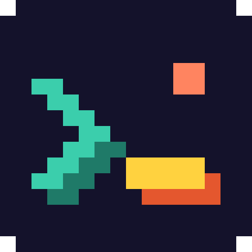
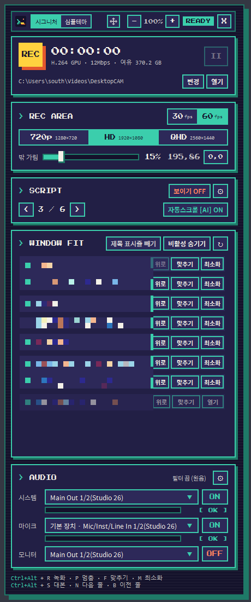
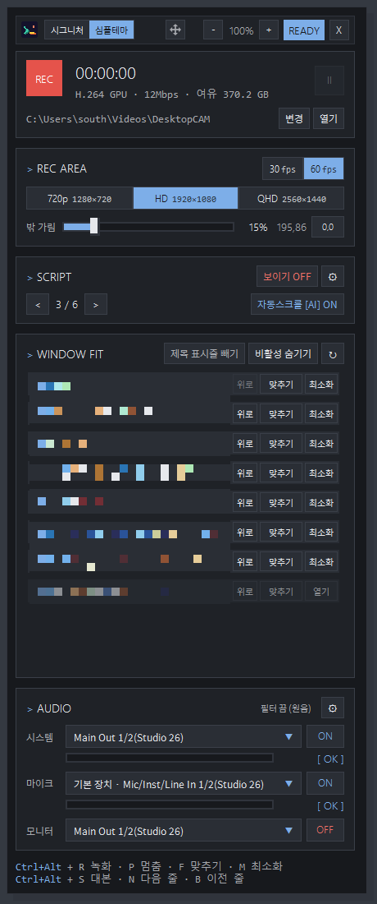
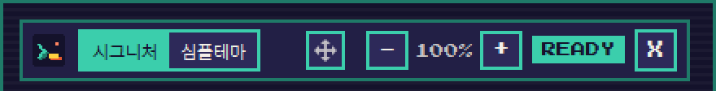
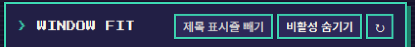
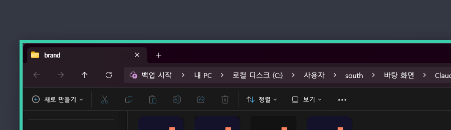
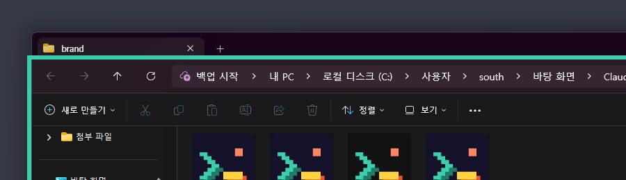
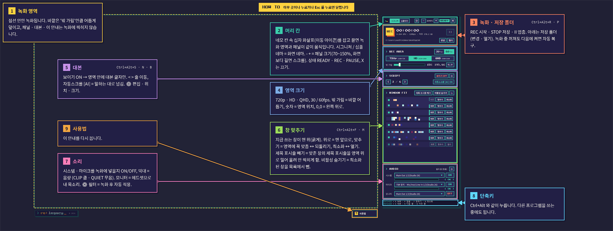
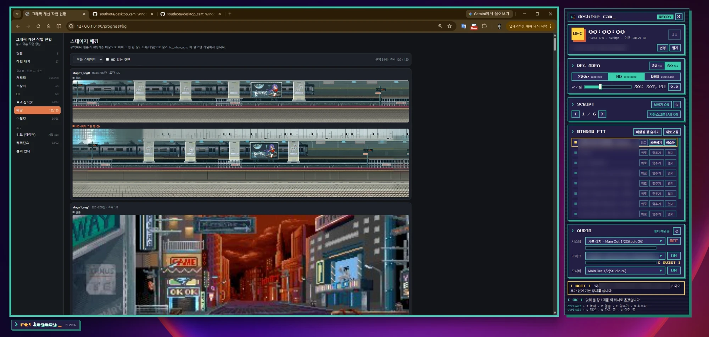

# Desktop CAM

> 유튜브용 HD·QHD 영역 녹화. 모니터 크기와 상관없이, 정해진 크기의 녹화 영역에 창을 맞추고 그대로 녹화합니다.



## 0.5.3 변경 사항

- **후원 계좌 안내**: 켤 때 녹화 영역 가운데에 후원 계좌가 뜹니다. 오른쪽 위 ✕ 로 닫으면 그 실행 동안은 다시 뜨지 않고, 녹화에는 찍히지 않습니다.

## 0.5.2 변경 사항

- **Windows 배율(125% · 150%)에서 패널이 찌그러지던 문제 수정**: 패널 전체를 같은 비율로 키우고 줄여, 배율과 상관없이 같은 크기로 보입니다.
- **패널 크기 `-` `+` (70~150%)**: 위쪽을 기준으로 아래 · 오른쪽으로 커지고, 화면보다 길면 전용 스크롤바로 내려 봅니다.
- **테마: 시그니처 · 심플테마**: 머리 칸에서 바로 바꾸고, 모든 창에 같이 적용됩니다.
- **머리 칸 이동 아이콘**: 네모 칸 속 십자 화살표를 잡고 끌면 녹화 영역과 패널이 같이 움직입니다.
- **제목 표시줄 빼기 (WINDOW FIT)**: 맞춘 창을 제목 표시줄 높이만큼 위로 올려, 제목 표시줄이 녹화 영역 밖에 걸리게 합니다. `비활성 숨기기`, 새로고침 `↻` 도 같은 줄에 있습니다.
- **끌 때 원래 자리로**: Desktop CAM 을 끄면 영역에 맞춰 둔 창이 원래 자리 · 크기로 돌아갑니다.
- **사용법 안내 개편**: 글자 두 배, 번호 · 색으로 짝을 맞춘 네모 + 화살표, 설명 상자는 녹화 영역 안에 배치.

| 시그니처 | 심플테마 |
| --- | --- |
|  |  |

머리 칸 (테마 · 이동 · 패널 크기), WINDOW FIT (제목 표시줄 빼기 · 비활성 숨기기 · 새로고침):




| 제목 표시줄 빼기 끔: 탭 줄까지 영역 안 | 켬: 탭 줄은 영역(teal 테두리) 위로 |
| --- | --- |
|  |  |

사용법 안내:



그림을 더 보려면 [설명서](docs/manual/README.md) (심플테마 사용법 · 150% 스크롤바 포함). 그림의 창 목록은 개인 창 제목이라 모자이크했습니다.

## 왜 만들었나

### "화면이 녹화되는 위치에, 녹화해야 할 창을 딱 맞출 수 없나?"
모니터 비율과 영상 비율이 달라서, 녹화할 때마다 영역 위치를 잡고 창 크기를 손으로 맞추는 게 매번 번거로웠습니다.
**그래서 만들었습니다.** 녹화 영역을 HD·QHD 크기로 고정해 두고, **창 맞추기** 한 번이면 창이 그 영역에 딱 맞춰집니다. 녹화하는 중에도 됩니다.

### "스크립트를 녹화 화면에 좀 띄울 수 없나?"
대본을 다른 창에 띄워 두고 보면서 넘기려니 시선도 손도 바빴습니다.
**그래서 넣었습니다.** 대본은 녹화 영역 위에 글자만 떠 있고 영상에는 찍히지 않습니다. **자동스크롤 [AI]**를 켜 두면 읽는 목소리를 듣고 다음 줄로 알아서 넘어갑니다.



## 실행 환경

| | 최소 | 권장 |
| --- | --- | --- |
| 운영체제 | Windows 10 버전 2004 (64비트) | Windows 11 |
| 화면 | 녹화 영역 + 패널(약 470px)이 들어가는 크기. 720p 영역이면 1920×1080 모니터 | QHD 영역은 3440×1440 이상, HD 영역은 2560×1440 이상 |
| 그래픽 | DirectX 11 | H.264 하드웨어 인코딩 (NVIDIA NVENC · AMD AMF · Intel Quick Sync) |
| 메모리 | 4GB | 8GB 이상 (자동스크롤 [AI] 를 켜면 약 450MB 더 씀) |
| 저장 공간 | 프로그램 약 210MB (+ 음성 모델 250MB) | 녹화용 여유 공간: QHD 60fps 기준 1분에 약 180MB |
| 인터넷 | 없어도 됨 | 음성 모델을 처음 받을 때 한 번만 |

- Windows 10 2004 보다 오래된 버전에서는 패널 · 대본 · 사용법 안내가 녹화에 같이 찍힙니다.
- 하드웨어 인코딩이 없는 PC 에서는 CPU 로 인코딩하므로 높은 해상도 · 60fps 에서 프레임이 떨어질 수 있습니다.

## 설치 · 실행

1. [Releases](../../releases/latest) 에서 `DesktopCAM-버전-win-x64.zip` 을 받아 원하는 곳에 풉니다.
2. `DesktopCAM\DesktopCam.exe` 를 실행합니다. 따로 설치할 것은 없습니다 (.NET 런타임 포함, 처음 한 번은 켜지는 데 몇 초 더 걸립니다).
   - 처음 실행할 때 "Windows의 PC 보호" 가 뜨면 **추가 정보 → 실행** 을 누르세요 (서명하지 않은 프로그램이라 뜹니다).
   - 녹화가 시작되지 않으면 [Visual C++ 재배포 패키지 x64](https://aka.ms/vs/17/release/vc_redist.x64.exe) 를 설치하세요.
3. 자동스크롤 [AI] 을 처음 켜면 한국어 음성 모델(약 83MB)을 받을지 묻습니다. 한 번만 받으면 됩니다.

## 화면 구성

> 0.5.2 에서 바뀐 테마 · 패널 크기 · 제목 표시줄 빼기 · 사용법 안내는 그림 설명서 [docs/manual](docs/manual/README.md) 에 있습니다.

- **녹화 영역**: 1280×720(720p), 1920×1080(HD), 2560×1440(QHD). 바깥은 어둡게 덮이고, 테두리는 대기 중 테마 강조색(시그니처 teal · 심플테마 파랑), 녹화 중 빨강.
- **패널**: 녹화 영역 오른쪽에 붙습니다. 기본 크기는 높이 1080 픽셀이고, Windows 배율(125% · 150% 등)과 상관없이 같은 모습입니다. 머리 칸의 `-` `+` 로 70~150% 까지 키우거나 줄일 수 있습니다. 패널 위쪽은 그대로 두고 아래·오른쪽으로 커지며, 화면보다 길어지면 패널을 마우스 휠이나 오른쪽 스크롤바로 내려 봅니다 (창 목록 위에서 휠을 굴리면 목록이 움직임). 크기는 다음에 켜도 그대로입니다. 머리 칸의 이동 아이콘(네모 칸 속 십자 화살표)을 잡고 끌면 영역과 패널이 함께 움직입니다.
- **테마**: 머리 칸의 `시그니처` / `심플테마` 로 바꿉니다. 누르면 모든 창(패널 · 대본 · 소리 설정 · 대본 편집 · 사용법)에 바로 적용되고, 다음에 켜도 그대로입니다.
  - 시그니처: 픽셀 글꼴, 주사선 배경, teal · 노랑 강조 (원래 디자인)
  - 심플테마: 일반 글꼴(얇게, 작은 글자는 조금 크게), 단색 배경, 얇은 회색 테두리, 강조색은 파랑 하나. 녹화 중 빨강 · 경고 노랑은 같음

기본 크기(100%)에서는 모든 칸이 한 화면에 함께 보입니다. 창 목록이 남는 높이를 씁니다.

| 칸 | 하는 일 |
| --- | --- |
| 머리 | 로고 · 테마(`시그니처` / `심플테마`) · 이동 아이콘(네모 칸 속 십자 화살표, 끌어서 녹화 영역 옮기기) · 패널 크기(`-` `+`, 70~150%) · 상태(READY / REC / PAUSE) · 끄기 |
| 녹화 | REC · 경과 시간 · 저장 폴더 |
| REC AREA | 720p/HD/QHD · 30/60fps · 녹화 밖 가림 · 위치 |
| SCRIPT | 대본 불러오기·편집·프롬프트 복사, 보이기, 이전/다음 줄, 자동스크롤 [AI], 위치(위·아래·왼쪽·오른쪽), 글자 크기 |
| WINDOW FIT | 창 목록 (지금 쓰는 창이 맨 위). 위로, 맞추기 / 되돌리기, 최소화 / 열기. 칸 제목 옆의 제목 표시줄 빼기(맞춘 창을 위로 늘려 제목 표시줄을 녹화 영역 위로 밀어 올림. 제목 표시줄은 안 찍히고 내용이 영역에 꽉 참, 끄면 영역 안으로 다시 맞춤, 되돌리기는 원래 위치로), 비활성 숨기기(최소화된 창을 목록에서 뺌), ↻ 새로고침 |
| AUDIO | 시스템 소리 · 마이크 장치, 실시간 음량, ON/OFF, 모니터(내 목소리 듣기) |

## 사용법 안내

녹화 영역 바깥 오른쪽 아래의 **? 사용법** 버튼을 누르면, 지금 떠 있는 화면 위에 설명이 **한꺼번에** 뜹니다 (녹화 영역 · 머리 칸 · 녹화 · 영역 크기 · 대본 · 창 맞추기 · 소리 · 단축키 · 사용법). 넘기는 단계는 없습니다.

- 설명할 칸마다 굵은 네모를 두르고, 설명 상자에서 그 네모까지 화살표를 긋습니다. 상자 · 네모 · 화살표는 짝마다 같은 색이고, 상자에 번호(1, 2, …)가 붙습니다.
- 설명 상자는 녹화 영역 안 빈 곳에 서로 · 화살표와 겹치지 않게 놓입니다. 영역 안에 자리가 모자라면 그때 영역 밖에 놓고, 그래도 없으면 상자를 조금 줄입니다.
- 글자 크기는 패널 글자의 약 두 배이고, 패널 크기(`-` `+`)를 따라 같이 커지고 작아집니다.
- 패널이 스크롤돼 가려진 칸은 건너뜁니다.

- 닫기: 아무 곳이나 클릭 또는 `Esc`
- 안내와 버튼은 녹화에 찍히지 않습니다.

## 단축키

| 키 | 동작 |
| --- | --- |
| Ctrl+Alt+R | 녹화 시작 / 저장 |
| Ctrl+Alt+P | 멈춤 / 이어서 |
| Ctrl+Alt+F | 앞에 있는 창을 영역에 맞추기 / 되돌리기 |
| Ctrl+Alt+M | 앞에 있는 창 최소화 / 다시 열기 |
| Ctrl+Alt+S | 대본 보이기 / 숨기기 |
| Ctrl+Alt+N / B | 대본 다음 줄 / 이전 줄 |

## 대본 (프롬프터)

- 대본 파일은 `.md`(권장) 또는 `.txt`. 한 줄이 한 번에 읽을 문장입니다.

  | 쓰는 법 | 화면 |
  | --- | --- |
  | `## 섹션` | 섹션 이름이 작게 (읽지 않음). `.txt` 에서는 `#` 줄이 메모 |
  | `**강조**` | 노란색 |
  | `> 메모` | 다음 문장 위에 노란 작은 글씨로 뜨는 연출 지시 (읽지 않음) |
  | `<!-- 주석 -->`, `---` | 무시 |

- SCRIPT 칸의 **⚙ 편집** 을 누르면 대본 편집 창이 열립니다.
  - 직접 고치기(고치는 내용은 저장 전에도 바로 화면에 반영), 새 대본·불러오기·저장(Ctrl+S)·다른 이름으로
  - 넣기 도우미: `## 섹션`, `**강조**`, `> 메모`, **긴 줄 나누기**(40자 넘는 문장을 문장 끝·쉼표·띄어쓰기에서)
  - 줄 목록: 섹션별로 보이고, 누르면 그 줄로 이동. 40자 넘는 줄은 번호가 노란색
  - 화면: 위치(위·아래·왼쪽·오른쪽), 크기, 이전 줄·섹션·메모 보이기, 다음 줄 수(0~2)
  - 자동스크롤 [AI]: 켜기/끄기, 넘김 기준(빠르게·보통·정확하게), **들린 말**(인식된 글자와 지금 줄 일치율)
  - 읽을 줄 수, 섹션 수, 읽는 시간 어림, 긴 줄 개수
- **프롬프트 복사** 버튼(편집 창): 서술형 원고를 이 형식으로 다듬어 달라는 AI 프롬프트를 복사합니다. AI 채팅에 붙여 넣고 끝에 원고를 넣으면, 그대로 저장해 쓸 수 있는 `.md` 대본이 나옵니다 (숫자·영어는 읽는 대로 한글로 바꿔 자동스크롤 [AI]이 잘 따라가게 함).
- 바탕 없이 어두운 테두리를 두른 글자만 떠서 밝은 화면·어두운 화면 어디서나 읽힙니다. 위치는 녹화 영역의 위·아래·왼쪽·오른쪽, 크기는 60~200%.
- **녹화에는 찍히지 않고**, 마우스 클릭은 아래 창으로 통과합니다.
- **자동스크롤 [AI]**: 말한 내용이 지금 줄과 거의 맞으면(85%) 바로, 말이 끊겼을 때 절반 이상 맞으면 다음 줄로 넘어갑니다. 대본에 없는 말은 넘기지 않습니다.
  - 인식은 인터넷 없이 PC 안에서 합니다 (Vosk 한국어 소형 모델, 켜 둔 동안 메모리 약 450MB, CPU 코어 하나의 10% 안팎).
  - 모델: 처음 켤 때 프로그램이 받아 실행 폴더의 `models\vosk-model-small-ko-0.22` 에 둡니다 (쓸 수 없는 폴더면 `%LOCALAPPDATA%\DesktopCAM\models`). 손으로 넣으려면 https://alphacephei.com/vosk/models 에서 받아 그 자리에 풀면 됩니다.

## 모니터 (내 목소리 듣기)

- 마이크 소리를 고른 장치(헤드셋)로 바로 들려줍니다. 헤드셋이 빠지면 멈추고(`WAIT`), 다시 연결되면 자동으로 켜집니다.
- 녹화하는 시스템 소리 장치와 같은 장치는 고를 수 없습니다(`SAME`). 같은 장치로 내보내면 목소리가 두 번 녹음되기 때문입니다.

## 상태 표시

| 표시 | 뜻 |
| --- | --- |
| `[ OK ]` | 소리가 정상으로 들어옵니다 |
| `[ CLIP ]` | 너무 커서 찢어질 수 있습니다 |
| `[ QUIET ]` | 마이크에 10초 넘게 소리가 없습니다 |
| `[ MUTE ]` | Windows에서 마이크가 음소거되어 있습니다 |
| `[ NONE ]` | 장치가 없습니다 |

## 마이크 다듬기 (잡음 제거 · EQ · 프리셋)

AUDIO 칸 오른쪽 위 ⚙ 에서 고릅니다. 녹화하는 동안 마이크는 따로 원음으로 받고, **녹화가 끝나면** 고른 설정으로 다듬어 영상에 합칩니다 (영상은 다시 인코딩하지 않음, 1시간 녹화면 3~4분).

| 프리셋 | 하는 일 |
| --- | --- |
| 원음 | 다듬지 않음 (녹화기가 마이크를 바로 녹음) |
| 목소리 기본 (기본값) | 웅웅거림 자르기 · 잡음 제거 · 말 사이 잡음 낮추기 · 살짝 또렷하게 · 음량 맞추기 |
| 잡음 많은 방 | AI 잡음 제거(RNNoise) · 말 사이 잡음 낮추기 · 또렷하게 |
| 선명하게 / 따뜻하게 | 고음을 올려 또박또박 / 저음을 살려 부드럽게 |
| 사용자 | 잡음 제거(끔·약하게·강하게 AI), 말 사이 잡음, 웅웅거림 자르기(Hz), 저음·중음·또렷함·공기감 EQ, 크기 고르게(압축), 음량 맞추기(-16 LUFS) |

- **미리 듣기**: 5초 녹음 → 원음 / 적용해서 듣기
- **NVIDIA Broadcast** 가 설치돼 있으면 그 마이크를 찾아 줍니다 (RTX AI 잡음 제거를 실시간으로).
- 원본도 남기기를 켜면 처리 전 영상(`_원본.mp4`)과 마이크(`_원본_마이크.wav`)도 남습니다.
- 모니터(헤드셋)와 자동스크롤 [AI]에는 원음이 쓰입니다.
- 필요한 것: 실행 폴더의 `tools\ffmpeg.exe`, `cb.rnnn`(AI 잡음 제거 모델) — 배포 폴더에 들어 있음. 없으면 원음으로 녹음합니다.

## 녹화 중 꺼지면

- 조각 MP4(fragmented MP4)로 저장해서, 몇 초마다 재생 목차를 같이 씁니다. 녹화 중에 PC 가 꺼지거나 프로그램이 강제로 끝나도 **직전 약 1초 전까지** 남습니다.
- 마이크 다듬기를 쓰던 중이었다면, 따로 받던 마이크 파일도 고쳐서 마저 다듬어 합칩니다.
- 다음에 프로그램을 켜면 끊긴 파일을 찾아 **길이 정보를 고치고, 반쯤 써진 꼬리를 잘라** 일반 플레이어·편집 프로그램에서 바로 열리게 합니다. 아래 알림 줄에 "지난 녹화가 중간에 끊겨 mm:ss까지 살렸습니다"가 뜹니다.

## 저장

`동영상\DesktopCAM\yyyy-MM-dd_HHmmss.mp4` · H.264(GPU) + AAC 192kbps. 비트레이트는 유튜브 권장값(1080p60 12Mbps, 1440p60 24Mbps).

## 개발

```
src/DesktopCam   WPF (.NET 8, x64) · ScreenRecorderLib · NAudio
tools/make_icon.py   로고·아이콘 생성 (픽셀 격자 16×16)
brand/               로고 원본: desktopcam-icon.svg(바탕 포함) · desktopcam-mark.svg(바탕 없음) · .ico · 512px PNG
```

빌드 (실행 파일 하나): `dotnet publish src/DesktopCam -c Release -r win-x64 --self-contained true -p:PublishSingleFile=true -p:IncludeAllContentForSelfExtract=true -p:EnableCompressionInSingleFile=true -p:DebugType=none -o out/DesktopCAM`

마이크 다듬기를 쓰려면 `out/DesktopCAM/tools/` 에 [ffmpeg LGPL 빌드](https://github.com/BtbN/FFmpeg-Builds/releases)의 `ffmpeg.exe` 와 [cb.rnnn](https://github.com/GregorR/rnnoise-models) 을 넣습니다.

배포: `v0.5.0` 처럼 `v` 로 시작하는 태그를 올리면 GitHub Actions(`.github/workflows/release.yml`)가 빌드하고 ffmpeg · 잡음 제거 모델을 넣어 Releases 에 zip 을 올립니다.

## 라이선스

Desktop CAM 은 [MIT 라이선스](LICENSE)입니다. 함께 쓰는 라이브러리 · 도구 · 서체는 [THIRD-PARTY-NOTICES.md](THIRD-PARTY-NOTICES.md) 를 보세요.

---

© 2026 `> re:legacy_`
