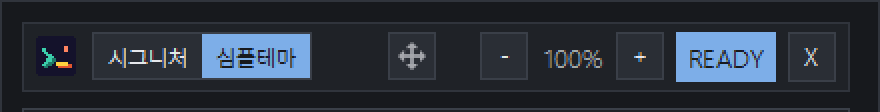
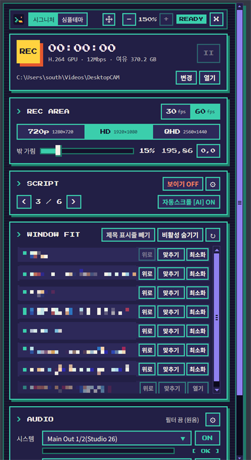
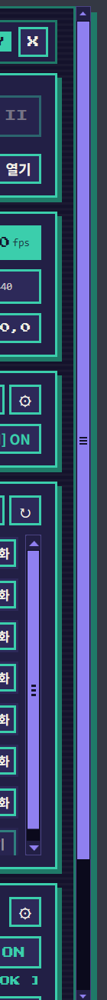
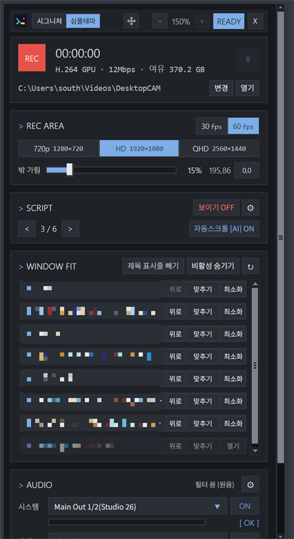
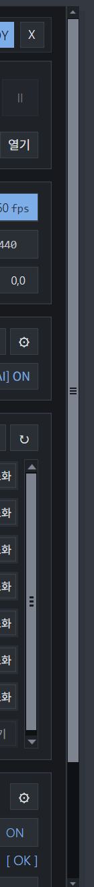
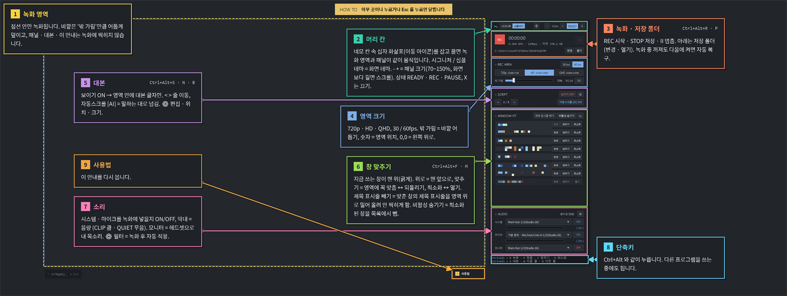

# Desktop CAM 0.5.2 설명서

0.5.2 에서 바뀐 화면과 기능을 그림으로 설명합니다. 기본 사용법은 [README](../../README.md) 를 보세요.

> 그림의 창 목록은 개인 창 제목이라 모자이크했습니다.

## 1. 테마: 시그니처 · 심플테마

머리 칸 왼쪽의 `시그니처 | 심플테마` 를 누르면 바로 바뀝니다. 패널 · 대본 · 소리 설정 · 사용법 안내 · 녹화 영역 테두리가 모두 같이 바뀌고, 다음에 켜도 그대로입니다.

| 시그니처 | 심플테마 |
| --- | --- |
|  |  |
| 픽셀 글꼴 · 스캔라인 배경 · teal 강조 | 일반 글꼴(얇게) · 단색 배경 · 파랑 강조 하나 |

녹화 중 빨강, 경고 노랑은 두 테마 모두 같습니다.

## 2. 머리 칸: 테마 · 이동 · 패널 크기

- **시그니처 | 심플테마**: 화면 테마.
- **네모 칸 속 십자 화살표**: 잡고 끌면 녹화 영역과 패널이 같이 움직입니다.
- **- 100% +**: 패널 크기 70~150% (10% 씩). 왼쪽 위를 기준으로 아래 · 오른쪽으로 커집니다.
- Windows 배율(125% · 150% 등)과 상관없이 패널은 늘 같은 크기로 보입니다. 배율을 쓰는 PC 에서 패널이 찌그러지던 문제를 고쳤습니다.

## 3. 패널이 화면보다 길면: 스크롤바

패널을 키워 화면보다 길어지면 오른쪽에 스크롤바가 생깁니다. 손잡이에 줄 3개, 위 · 아래 화살표가 있고, 테두리 색과 헷갈리지 않게 따로 색을 씁니다 (시그니처 라벤더, 심플테마 회색). 창 목록 위에서 휠을 굴리면 목록이, 그 밖에서는 패널 전체가 움직입니다.

| 150% 패널 | 스크롤바 확대 |
| --- | --- |
|  |  |
|  |  |

## 4. WINDOW FIT: 제목 표시줄 빼기

- **제목 표시줄 빼기**: 켜 두면 맞춘 창을 제목 표시줄 높이만큼 위로 올려, 제목 표시줄(탭 줄)이 녹화 영역 바깥 위쪽에 걸리게 맞춥니다. 영역 안에는 창 내용만 찍힙니다.
- **비활성 숨기기**: 최소화된 창을 목록에서 숨깁니다 (`비활성 보이기` 로 다시 표시).
- **↻**: 창 목록 새로고침.

| 끔: 탭 줄까지 영역 안 | 켬: 탭 줄은 영역(teal 테두리) 위로 |
| --- | --- |
|  |  |

- 제목 표시줄 높이: Windows 가 그리는 표시줄은 실제 높이를 재고, 프로그램이 직접 그리는 표시줄(Chrome · 탐색기 · 터미널 · Electron 앱)은 40px × Windows 배율을 씁니다.
- 영역이 화면 맨 위에 있어 창을 더 올릴 수 없으면 알림이 뜹니다. 영역을 조금 아래로 옮기세요.
- Desktop CAM 을 끄면, 아직 영역에 맞춰져 있는 창은 원래 자리 · 크기로 돌아갑니다.

## 5. 사용법 안내

녹화 영역 바깥 오른쪽 아래 **? 사용법** 을 누르면 뜹니다. 글자를 두 배로 키우고, 설명 상자를 녹화 영역 안쪽에 넉넉하게 배치했습니다. 상자 · 칸 테두리 · 화살표가 같은 번호와 색이라 어떤 설명이 어느 칸인지 바로 보입니다. 아무 곳이나 누르거나 `Esc` 로 닫습니다.

안내와 버튼은 녹화에 찍히지 않습니다.
